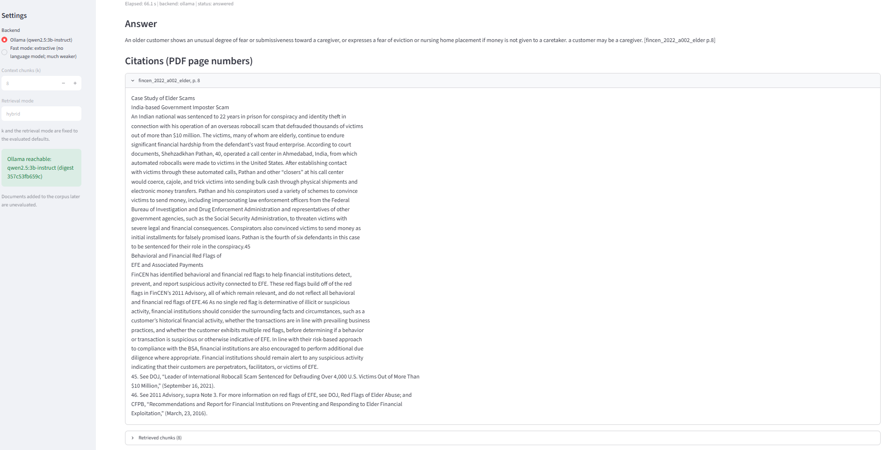

# Fraud & Financial Crime Policy Assistant

A retrieval-augmented question-answering system over 15 public fraud and anti-money-laundering documents (FinCEN,
FATF, FFIEC, 31 CFR 1020.320 and CFPB Regulation E). It answers with document and page citations, can decline when the
retrieved text does not support an answer, and comes with a quantitative evaluation. Everything runs locally on CPU;
no API key is needed.

> **Research demo. It may be wrong, so check the citations. It is not legal or compliance advice.**



*(Screenshot placeholder: add `docs/screenshot.png`.)*

## Headline results (development questions only)

All 20 evaluation questions are dev questions and there is no held-out split; the default retrieval mode was chosen
on them, one prompt change was made after seeing dev results, and the samples are small. These numbers do not show
how the system would do on new questions. Full detail, intervals and the list of claims the evidence does not
support are in [reports/rag_validation_report.md](reports/rag_validation_report.md).

**Owner human review (14 answerable questions, single reviewer, no inter-annotator agreement):** 9 correct,
4 partial, 1 incorrect; the cited text supports the claim in 9 of 14. Table: [reports/human_review_owner.md](reports/human_review_owner.md).

- **Citations are weaker than answers.** 8 of 10 numeric citation pairs in the language-model answers (14 answerable
  questions) cite a page that does not contain the number, so a "valid citation" (a page that was retrieved) overstates how
  well a claim is supported.
- **Retrieval** (hybrid, 512/64 chunks, exact dense search, 14 questions): any gold page in the top 8 for 1.00, all gold
  pages in the top 8 for 0.86 [0.64, 1.00].
- **Refusal:** the similarity gate refused 0 of 4 unanswerable questions; the model's `INSUFFICIENT_CONTEXT` handled 3 of 4.
- **Injection:** one of two dev injection questions never reached the model; the other was answered without addressing
  the question. A small synthetic probe is not part of the eval set and was written by the same author as the sanitiser.
- **Conflicting sources:** the system cites the newest source in 2 of 2 questions. Both answers give the newer (2025) position and cite that source, but neither mentions the conflict or the older guidance (0 of 2 on the recency-word check).

## Limitations

A 3B model on CPU (about a minute per question); prompt v2, the hybrid default and other choices were made on dev data;
run-to-run variation exists despite temperature 0; the default Chroma dense search is not fully deterministic across
processes (2 of 20 queries in 2 processes, both non-answerable); Regulation E is 58.5% of the index; latency was
transcribed by hand from a run summary. See sections 6 and 7 of the validation report.

## Setup

Tested with Python 3.14.8 on Windows (CPU only). Commands use the venv Python.

```bash
python -m venv .venv
.venv\Scripts\activate                     # Windows; use source .venv/bin/activate elsewhere
python -m pip install -r requirements.txt  # pinned versions used for the evaluation
python -m pip install -e .
```

Language-model backend (optional; the extractive backend needs no model):

1. Install Ollama from https://ollama.com and start it (it listens on http://localhost:11434).
2. `ollama pull qwen2.5:3b-instruct` (the evaluated digest starts `357c53fb659c`).

The first run also downloads the BAAI/bge-small-en-v1.5 embedding model and tokenizer from Hugging Face. The app then
runs offline.

## Commands

Source PDFs go in `data/raw/` (see Data sources). FATF and FFIEC block scripted downloads: save those four PDFs by hand
under the names in `data/manifest.csv`.

```bash
# Ingestion, extraction, cleaning (Phase 1)
python -m fincrime_rag.ingestion download && python -m fincrime_rag.ingestion verify
python -m fincrime_rag.extraction && python -m fincrime_rag.cleaning && python -m fincrime_rag.qa

# Chunks, embeddings, index (Phases 2-3); idempotent
python -m fincrime_rag.chunking && python -m fincrime_rag.vectorstore build
python -m fincrime_rag.guardrails calibrate          # refusal threshold from the corpus (no eval question used)

# Evaluation and reports
python -m fincrime_rag.evalset validate              # schema check of data/eval/qa_set.jsonl (read-only)
python -m fincrime_rag.evaluate retrieval            # -> reports/retrieval_results.md
python -m fincrime_rag.experiments run               # exact-search grid -> reports/retrieval_experiments.md
python scripts/eval_generation.py --ollama-ablation  # -> reports/generation_results.md (needs Ollama)
python scripts/eval_generation.py --cached-only      # recompute from cached replies, never calls the model
python scripts/probe_injection.py                    # live injection probe (not part of the eval set)

# One question from the command line
python -m fincrime_rag.generation "your question" --backend extractive   # or --backend ollama

# Tests and lint
python -m pytest
python -m ruff check .

# Demo app
streamlit run app/streamlit_app.py
```

Cached model replies are kept in `.cache/llm` (delete it to measure latency again); `chroma_db/`, `.cache/` and the
derived files under `data/` are git-ignored.

## The demo app

`streamlit run app/streamlit_app.py`. A question box; the backend is Ollama if it is reachable, otherwise you are told and
may choose the extractive "fast mode" (a much weaker backend that only quotes sentences). There is no silent fallback.
Retrieval is fixed to the evaluated defaults (hybrid, k = 8) and shown but not editable. The app shows the answer, its
citations (document and PDF page) with the cited page text, the retrieved chunks, the refusal reason, and elapsed time.
It makes no network calls except to a local Ollama server, disables Streamlit usage statistics, and does not write
questions to disk. Documents added to the corpus later would be unevaluated.

## Repository layout

```
config.yaml              all tunables, validated by src/fincrime_rag/config.py
DECISIONS.md  PLAN.md  CLAUDE.md
data/manifest.csv        the 15 documents (PDFs and derived data are git-ignored)
data/eval/qa_set.jsonl   the frozen 20-question dev set (owner-written; never edited by the pipeline)
src/fincrime_rag/        ingestion, extraction, cleaning, chunking, embeddings, vectorstore, retrieval, generation,
                         prompting, citations, guardrails, llm/ (Ollama and extractive), evaluation/, experiments, service
app/streamlit_app.py     the demo
scripts/                 generation evaluation and the injection probe
reports/                 extraction QA, retrieval and generation results, experiments, the validation report
tests/                   unit tests (no network or model calls; the app smoke test needs a built index)
```

## Data sources

The 15 documents are public publications listed in `data/manifest.csv` with URL, date, publisher and a licence note:
FinCEN advisories, alerts, trend analyses and SAR FAQs; 31 CFR 1020.320 and 12 CFR Part 1005 (Regulation E) from GovInfo;
FFIEC BSA/AML Examination Manual sections; and two FATF reports (copyright FATF, attribution required; reproduction
needs permission). The PDFs are **not** redistributed in this repository: download them or place them in `data/raw/`.

## Design notes

Every design choice, with options and reasons, is in [DECISIONS.md](DECISIONS.md) (D-001 onward); the phased plan is in
[PLAN.md](PLAN.md). The evaluation set provenance is in D-007.

## Licence

Not yet chosen (open item for the owner).
